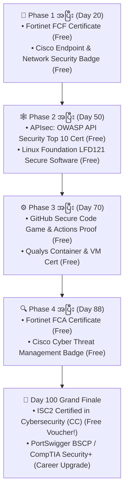

# 🎓 Complete Cybersecurity & DevSecOps Certifications, Free Vouchers & Diploma Guide

> **Remote / Work-From-Home အလုပ်လျှောက်တဲ့အခါ HR နဲ့ Hiring Manager တွေ ယုံကြည်မှုရှိစေဖို့ ရက် (၁၀၀) လေ့လာရင်း ရယူနိုင်မည့် နိုင်ငံတကာ အသိအမှတ်ပြု လက်မှတ်များ (Free & Paid)**

Remote အလုပ်လျှောက်ရာမှာ အဆင့် (၂) ဆင့် ဖြတ်ရပါတယ်—
1. **အဆင့် (၁) HR & ATS Filter:** HR က မင်းရဲ့ Code ကို အရင်မကြည့်ပါဘူး၊ Resume/LinkedIn ပေါ်မှာ **Recognized Certificates / Badges** ပါလား အရင်ကြည့်ပါတယ်။
2. **အဆင့် (၂) Technical Interview:** Senior Engineer က မင်းရဲ့ **GitHub Portfolio (`100-days-cybersecurity-devsecops`)** နဲ့ လက်တွေ့ ပြဿနာဖြေရှင်းနိုင်စွမ်းကို ကြည့်ပါတယ်။

ဒီ Guide ထဲမှာ မင်းရဲ့ **100 Days Roadmap** နဲ့ တိုက်ရိုက်ချိတ်ဆက်ထားတဲ့ **100% Free Official Certificates ($0)** တွေနဲ့ **High-ROI Career Certifications** တွေကို ဘယ်လို အဆင့်ဆင့် ရယူမလဲဆိုတာ အသေးစိတ် ရှင်းပြထားပါတယ်။

---

## 🗺️ Certification Timeline (Phase 1 မှ Day 100 အထိ)

---

## 🆓 အပိုင်း (၁) — 100% အခမဲ့ (Free) ဖြေဆိုရယူနိုင်သော နိုင်ငံတကာ အသိအမှတ်ပြု လက်မှတ်များ ($0 Cost)

### 1. 🌟 ISC2 Certified in Cybersecurity (CC) — *(နံပါတ် ၁ အရေးအကြီးဆုံး Free Official Certification!)*
- **ပေးအပ်သည့် အဖွဲ့အစည်း:** **ISC2** (ကမ္ဘာ့အမြင့်ဆုံး CISSP လက်မှတ်ကို ပေးအပ်သည့် အဖွဲ့အစည်းကြီး)
- **ဘာကြောင့် ယူသင့်လဲ?** ပုံမှန်ဆိုရင် $199 တန်ဖိုးရှိပေမဲ့ ISC2 ရဲ့ *"One Million Certified in Cybersecurity"* အစီအစဉ်အရ **Official Online သင်တန်းရော စာမေးပွဲကြေး (Exam Voucher) ပါ 100% အခမဲ့** ပေးနေပါတယ်။ HR တွေကြားထဲမှာ အရမ်း နာမည်ကြီးပါတယ်။
- **ဘယ်အချိန်မှာ ဖြေမလဲ?** **Day 100** (Phase 1 ကနေ 4 အထိ သင်သမျှအားလုံးက ISC2 CC ရဲ့ Domain 5 ခုလုံးနဲ့ 100% ကိုက်ညီပါတယ်)။
- **ပါဝင်သည့် Domains (၅) ခု:**
  1. Security Principles (CIA Triad, Risk Management, Authentication)
  2. Business Continuity (BC), Disaster Recovery (DR) & Incident Response Concepts
  3. Access Controls Concepts (Least Privilege, RBAC, Physical/Logical Controls)
  4. Network Security (OSI Model, TCP/IP, Firewalls, Cloud, Segmentation)
  5. Security Operations (Encryption, Hardening, Log Monitoring, Security Policies)
- **လျှောက်ထားနည်း:** `https://www.isc2.org/landing/1mcc` တွင် Account ဖွင့်ပြီး Free Training + Free Exam Code ရယူနိုင်ပါတယ်။

---

### 2. 🔌 APIsec University Certificates — *(Backend / Laravel API Developer အတွက် အကောင်းဆုံး!)*
- **ပေးအပ်သည့် အဖွဲ့အစည်း:** **APIsec University** (`https://www.apisecuniversity.com/`)
- **ဘာကြောင့် ယူသင့်လဲ?** မင်းက Backend/API ရေးတဲ့ Developer ဖြစ်တဲ့အတွက် CV ပေါ်မှာ **API Security Certificate** ပါတာက တခြား Backend Dev တွေထက် အဆပေါင်းများစွာ သာသွားစေပါတယ်။ Credly Digital Badge နဲ့ PDF Certificate တန်းရပါတယ်။
- **အခမဲ့ ရယူနိုင်သည့် လက်မှတ် (၃) ခု (Target: Day 50 - Phase 2 အပြီး):**
  1. **OWASP API Security Top 10** Certificate
  2. **API Security Fundamentals** Certificate
  3. **API Penetration Testing** Certificate

---

### 3. 🛡️ Fortinet Certified Fundamentals (FCF) & Certified Associate (FCA) in Cybersecurity
- **ပေးအပ်သည့် အဖွဲ့အစည်း:** **Fortinet Training Institute** (`https://training.fortinet.com/`)
- **ဘာကြောင့် ယူသင့်လဲ?** ကမ္ဘာကျော် Firewall & Network Security ကုမ္ပဏီကြီး Fortinet က တရားဝင် ပေးအပ်တဲ့ Official Vendor Certification (၂) ခု ဖြစ်ပြီး သင်တန်းရော Online Exam ပါ 100% Free ဖြစ်ပါတယ်။
- **ဘယ်အချိန်မှာ ဖြေမလဲ?**
  - **Day 20 (Phase 1 အပြီး):** *Fortinet Certified Fundamentals (FCF)* (Threat Landscape + Technical Introduction to Cybersecurity)
  - **Day 88 (Phase 4 အပြီး):** *Fortinet Certified Associate (FCA)* (FortiGate Operator)

---

### 4. 🌐 Cisco Networking Academy (Skills for All / NetAcad) Verifiable Badges
- **ပေးအပ်သည့် အဖွဲ့အစည်း:** **Cisco** (`https://www.netacad.com/`)
- **ဘာကြောင့် ယူသင့်လဲ?** Cisco ရဲ့ Official Credly Digital Badges တွေဖြစ်လို့ LinkedIn Profile ရဲ့ *Licenses & Certifications* မှာ Verification Link နဲ့ တင်ထားလို့ ရပါတယ်။
- **အခမဲ့ ရယူနိုင်သည့် လက်မှတ်များ:**
  - **Day 20 (Phase 1 အပြီး):** *Introduction to Cybersecurity* & *Networking Basics / Endpoint Security*
  - **Day 88 (Phase 4 အပြီး):** *Cyber Threat Management* & *Junior Cybersecurity Analyst Career Path*

---

### 5. 🐧 The Linux Foundation — Developing Secure Software (LFD121)
- **ပေးအပ်သည့် အဖွဲ့အစည်း:** **The Linux Foundation / OpenSSF** (`https://training.linuxfoundation.org/training/developing-secure-software-lfd121/`)
- **ဘာကြောင့် ယူသင့်လဲ?** Software / Backend Developer တွေအတွက် Open Source Security Foundation (OpenSSF) နဲ့ Linux Foundation က ထုတ်ပေးထားတဲ့ Official Secure Coding သင်တန်းနဲ့ Completion Badge ဖြစ်ပါတယ်။
- **ဘယ်အချိန်မှာ ယူမလဲ?** **Day 50 (Phase 2 အပြီး)**။

---

### 6. 🐳 Qualys Free Security Certifications (Container & Vulnerability Management)
- **ပေးအပ်သည့် အဖွဲ့အစည်း:** **Qualys** (`https://www.qualys.com/training/`)
- **ဘာကြောင့် ယူသင့်လဲ?** DevSecOps Engineer အလုပ်လျှောက်တဲ့အခါ Vulnerability Management နဲ့ Container Security အသိအမှတ်ပြု လက်မှတ်ကို 100% Free Exam ဖြေပြီး ယူနိုင်ပါတယ်။
- **ဘယ်အချိန်မှာ ယူမလဲ?** **Day 70 (Phase 3 အပြီး)**။

---

## 🏆 အပိုင်း (၂) — 100 Days အပြီး အလုပ်အကိုင် အဆင့်မြှင့်ရန် High-ROI Paid Certifications

အခမဲ့ လက်မှတ်တွေ ယူပြီးနောက် နိုင်ငံတကာ Remote Job တွေမှာ လစာမြင့်မြင့်နဲ့ ဝင်ချင်တယ်ဆိုရင် အောက်ပါ (၃) ခုထဲက တစ်ခုကို ရွေးဖြေနိုင်ပါတယ်—

| Certification အမည် | စာမေးပွဲကြေး (ခန့်မှန်း) | စာမေးပွဲ ပုံစံ | ဘယ်သူတွေအတွက် အကောင်းဆုံးလဲ? |
| :--- | :--- | :--- | :--- |
| **1. PortSwigger Burp Suite Certified Practitioner (BSCP)** | **~$99 USD** *(ဈေးအသက်သာဆုံးနှင့် အရမ်းလေးစားခံရဆုံး)* | ၄ နာရီအတွင်း Web App ၂ ခုကို လက်တွေ့ হ্যাক (Exploit) လုပ်ရသည့် 100% Practical Exam | **AppSec / Web Pentester / Senior Security Backend Dev** (Phase 2 PortSwigger Labs တွေလုပ်ပြီးရင် တန်းဖြေနိုင်သည်!) |
| **2. CompTIA Security+ (SY0-701)** | **~$404 USD** | မိနစ် ၉၀ (MCQ + Performance-Based Questions) | **Remote DevSecOps / Cloud / Security Engineer** (ကမ္ဘာပေါ်မှာ HR တွေ အများဆုံး တောင်းတဲ့ #1 Security Cert) |
| **3. eJPT (Junior Penetration Tester - INE)** | **~$249 USD** | ၄၈ နာရီ Open-Book Practical Network & Web Hacking Exam | **Hands-on Red Team / Junior Pentester** |

---

## 💼 အပိုင်း (၃) — ရလာတဲ့ Certificates တွေနဲ့ 100-Day Repo ကို Remote CV / LinkedIn မှာ ဘယ်လိုပြမလဲ?

### 1. LinkedIn Profile Headline နမူနာ
> **Backend & DevSecOps Engineer (Laravel / Linux / Docker) | ISC2 CC • APIsec Certified | Building Secure APIs & Automated CI/CD Pipelines**

### 2. Resume / CV ထဲက "Certifications & Security Portfolio" ကဏ္ဍ နမူနာ
- **Certifications:**
  - *Certified in Cybersecurity (CC)* — ISC2
  - *OWASP API Security Top 10 & API Penetration Testing Certified* — APIsec University
  - *Fortinet Certified Associate (FCA) & Fundamentals (FCF) in Cybersecurity* — Fortinet
  - *Developing Secure Software (LFD121)* — The Linux Foundation
- **Featured Security Engineering Project:**
  - **100 Days of Cybersecurity & DevSecOps Lab Repository (GitHub):** Designed and executed 100 hands-on offensive and defensive labs covering Linux server hardening, Nginx pool isolation, OWASP Top 10/API security patches in Laravel, hardened Docker multi-stage builds, and automated GitHub Actions SAST/SCA/Secret-scanning pipelines.
