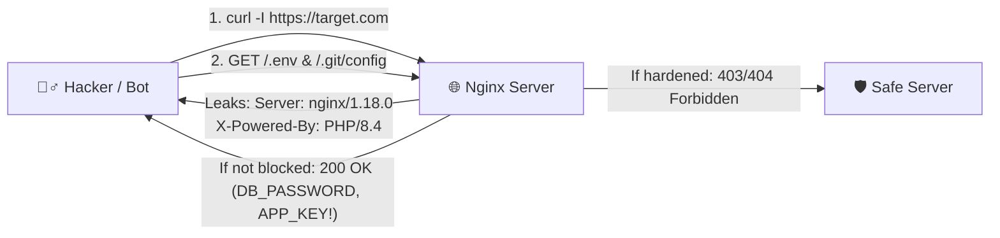

# 📅 Day 001: Anatomy of a Real Server Attack — Hacker တစ်ယောက်က မင်းရဲ့ Website နဲ့ Server ကို ပထမဆုံး စက္ကန့် ၆၀ အတွင်း ဘယ်လို မြင်သလဲ?

> **Phase:** Phase 1 (Linux, SSH, Nginx & Network Security) | **Time Spent:** 60 Mins  
> **Tech Stack Involved:** HTTP/HTTPS, Nginx, PHP-FPM, Laravel (`.env`, `.git`), `curl`  
> **🎓 Certification Alignment:** **ISC2 CC** (Domain 4: Network Security & Domain 5: Hardening) • **CompTIA Security+ (SY0-701)** (Objective 1.2 & 4.1: Reconnaissance & Attack Surface) • **APIsec Fundamentals**

---

## 🧠 1. The Story & How It Works Under the Hood (15 Mins)

### Hacker တွေက ရုပ်ရှင်ထဲကလို ချက်ချင်း ကီးဘုတ်ရိုက်ပြီး ဖောက်တာလား?
မဟုတ်ပါဘူး! အပြင်လောကမှာ Hacker တစ်ယောက် (သို့မဟုတ် Internet ပေါ်မှာ ၂၄ နာရီ ပတ်မွှေနေတဲ့ Automated Bot တစ်ကောင်) က Website တစ်ခုကို တွေ့တာနဲ့ ပထမဆုံး လုပ်တဲ့အဆင့်ကို **Reconnaissance (ကင်းထောက်ခြင်း / သတင်းအချက်အလက် စုဆောင်းခြင်း)** လို့ ခေါ်ပါတယ်။

သူတို့ အဓိက မေးခွန်း (၄) ခုကို စက္ကန့် ၆၀ အတွင်း စစ်ဆေးပါတယ်—
1. **ဒီ Server က ဘာ Web Server သုံးထားလဲ? Version ဘယ်လောက်လဲ?** (`Server: nginx/1.18.0 (Ubuntu)`)
2. **နောက်ကွယ်မှာ ဘာ Programming Language / Framework Run နေလဲ?** (`X-Powered-By: PHP/8.4`, `Set-Cookie: laravel_session=...`)
3. **Developer က မေ့ပြီး `.env` ဒါမှမဟုတ် `.git` folder ကို Public မှာ ချန်ထားမိလား?** (`GET /.env`, `GET /.git/config`)
4. **Error တက်အောင် လုပ်လိုက်ရင် Debug Page (`APP_DEBUG=true`) ပေါ်လာမလား?**



> [!IMPORTANT]
> **မင်းတို့ `starChannel` Server မှာ လက်တွေ့ဖြစ်ခဲ့တဲ့ သက်သေ!**  
> မနေ့က ငါတို့ `starChannel` ရဲ့ `/var/log/nginx/error.log` ကို စစ်တုန်းက ဒီ Log တစ်ကြောင်း တွေ့ခဲ့တာ မှတ်မိလား?
> ```text
> 2026/10/28 02:36:05 [error] 2932755#2932755: *90659 access forbidden by rule,
> client: 78.153.140.156, server: cp.starchannel.tv, request: "GET /.env HTTP/1.1", host: "167.71.216.226"
> ```
> အဲ့ဒါ IP `78.153.140.156` က Bot က မင်းတို့ Server ရဲ့ IP ကို တိုက်ရိုက်ရိုက်ပြီး `/.env` ဖိုင် ပွင့်နေလား လာနှိုက်ကြည့်သွားတာပါ! Nginx မှာ `location ~ /\.(?!well-known).* { deny all; }` ခံထားလို့သာ `access forbidden by rule` ဆိုပြီး ကာကွယ်နိုင်ခဲ့တာ ဖြစ်ပါတယ်။

---

## 🔴 2. Red Team Lab — Hacker မျက်စိဖြင့် ကိုယ်တိုင် စမ်းသပ်ကြည့်ခြင်း (15 Mins)

### 🎯 Lab Objective
မင်းရဲ့ Terminal ကနေ `curl` တစ်ခုတည်းသုံးပြီး Website တစ်ခုရဲ့ Response Headers တွေနဲ့ Hidden Files (`/.env`, `/.git/HEAD`) တွေကို Hacker တစ်ယောက်လို စစ်ဆေးကြည့်မယ်။

### 💻 Step-by-Step Commands (Terminal မှာ ကိုယ်တိုင် ရိုက်စမ်းကြည့်ပါ)

#### စမ်းသပ်ချက် (၁) — HTTP Response Headers များကို စစ်ဆေးခြင်း (`Banner Grabbing`)
```bash
curl -sI https://vvip9.co
```
**🔍 ဘာကို ကြည့်ရမလဲ?**
- `server: nginx/1.18.0 (Ubuntu)` ပေါ်နေသလား?
  - ပေါ်နေရင် Hacker က *"အော်... ဒီ Server က Ubuntu ပေါ်မှာ Nginx 1.18.0 သုံးထားတာပဲ"* ဆိုတာ အတိအကျ သိသွားပါတယ်။
- `set-cookie: ..._session=...; path=/; secure; httponly; samesite=lax` ပေါ်နေသလား?
  - Cookie နာမည်နဲ့ Format ကို ကြည့်ပြီး Laravel သုံးထားမှန်း သိနိုင်ပါတယ်။

#### စမ်းသပ်ချက် (၂) — Sensitive Dotfiles (`/.env`, `/.git/config`) လုံခြုံမှု စမ်းသပ်ခြင်း
```bash
curl -s -o /dev/null -w "GET /.env -> HTTP %{http_code}\n" https://vvip9.co/.env
curl -s -o /dev/null -w "GET /.git/config -> HTTP %{http_code}\n" https://vvip9.co/.git/config
```
**🔍 ရလဒ် အဓိပ္ပာယ်—**
- `HTTP 404` သို့မဟုတ် `HTTP 403` ပြန်လာရင် ➔ ✅ **လုံခြုံပါတယ်** (Nginx က ပိတ်ထားပါတယ်)။
- `HTTP 200` ပြန်လာရင် ➔ 🚨 **အရေးပေါ် အန္တရာယ်!** (Web Root က `/public` ကို မညွှန်ဘဲ Project Root ကို ညွှန်ထားမိလို့ `.env` တစ်ခုလုံး ပေါက်ကြားနေပြီ!)

#### စမ်းသပ်ချက် (၃) — Laravel Encrypted Cookie (`eyJpdiI6...`) ကို ခွဲစိတ်ကြည့်ခြင်း
`curl -sI` ရလဒ်ထဲက `starchanneltv_session=eyJpdiI6...` ကို Base64 Decode လုပ်ကြည့်တဲ့အခါ အောက်ပါ JSON ထွက်လာပါတယ်—
```json
{
  "iv": "RL0wGkgi5T9FXaFLki08Mg==",
  "value": "JWhQ3xLs+T+19TdR2KzaFhCNwhOKu0LVKobcZJhqMuh...",
  "mac": "6d0a660d7fff015829b0b6f49a58aec0acf1b17c994163b8b81d220a1f787a20",
  "tag": ""
}
```
- **`iv` (Initialization Vector):** AES-256-CBC Encryption အတွက် သုံးတဲ့ Random တန်ဖိုး။
- **`value`:** Laravel ရဲ့ `.env` ထဲက `APP_KEY` နဲ့ Encrypt လုပ်ထားတဲ့ Session ID / Data။
- **`mac` (Message Authentication Code):** Cookie ကို ကြားကနေ လက်ဆော့ပြီး ပြင်လို့မရအောင် `APP_KEY` နဲ့ပဲ တွက်ထားတဲ့ HMAC-SHA256 လက်မှတ်။
- **🚨 အရေးကြီးသင်ခန်းစာ:** အကယ်၍သာ `.env` ထဲက `APP_KEY` ပေါက်ကြားသွားရင် Hacker က ဒီ Cookie ကို အလွယ်တကူ Decrypt လုပ်နိုင်ရုံသာမက၊ သူကြိုက်တဲ့ User ID နဲ့ Cookie အတု (Forge) လုပ်ပြီး Admin အနေနဲ့ပါ ဝင်ရောက်နိုင်ပါတယ်!

#### စမ်းသပ်ချက် (၄) — `starChannel` Server ကို ဒီနေ့ လာစမ်းနေတဲ့ Real Hacker Bots များကို ဖမ်းယူခြင်း
```bash
grep -E '(\.env|\.git|phpmyadmin|wp-|phpunit|eval-stdin|config)' /var/log/nginx/access.log | tail -n 20
```
**`starChannel` Log ထဲတွင် လက်တွေ့ ဖမ်းမိသော တိုက်ခိုက်မှု ကြိုးပမ်းချက်များ—**
1. **`.env` Brute-Force (`46.151.178.15`):** တစ်စက္ကန့်တည်းမှာ `/.env`, `/.env.local`, `/.env.prod`, `/.env.backup`, `/api/.env`, `/laravel/.env` (၁၀) ခု ဆက်တိုက် လာစမ်းသွားသည် (`403 Forbidden` ဖြင့် Nginx က တားဆီးနိုင်ခဲ့သည်)။
2. **PHPUnit RCE Exploit (`94.26.0.103` - CVE-2017-9841):**
   `POST /vendor/phpunit/phpunit/src/Util/PHP/eval-stdin.php` — `/vendor` folder အပြင်ပေါက်နေသော Laravel site များတွင် Server ပေါ် တိုက်ရိုက် Command Run ရန် ကြိုးပမ်းချက်။
3. **Hidden Performance Drain (`wp-login.php`, `/admin/config.php`):**
   `187.17.224.223` က `/admin/config.php` ကို လှမ်းခေါ်ရာတွင် `404` ပြန်သော်လည်း Response Size က **`6603 bytes`** ဖြစ်နေသည်! ဆိုလိုသည်မှာ Nginx က မပိတ်ဘဲ `try_files` မှတစ်ဆင့် `/index.php` (PHP-FPM + Laravel) ဆီ ပို့လိုက်သဖြင့် Bot က လာစမ်းသမျှ URL တိုင်းအတွက် Laravel တစ်ခုလုံး အလုပ်လုပ်ပေးနေရသည်!

---

## 🔵 3. Blue Team / DevSecOps Fix — Production Server မှာ ဘယ်လို ပိတ်မလဲ? (15 Mins)

Hacker ကို ကိုယ့် Server ရဲ့ Version အချက်အလက်တွေ အလကား မပေးမိအောင် (Information Disclosure ကာကွယ်ရန်) အောက်ပါ (၃) ချက်ကို Production Server တိုင်းမှာ သတ်မှတ်ရပါမယ်—

### Fix 1: Nginx Version နှင့် OS အမည်ကို ဖျောက်ထားခြင်း (`server_tokens off;`)
`/etc/nginx/nginx.conf` ရဲ့ `http { ... }` block ထဲမှာ—
```nginx
http {
    # ❌ Default (Leaks: Server: nginx/1.18.0 (Ubuntu))
    # server_tokens off;

    # ✅ Hardened (Shows only: Server: nginx)
    server_tokens off;
}
```

### Fix 2: PHP Version ကို ဖျောက်ထားခြင်း (`expose_php = Off`)
Nginx Site Config (`/etc/nginx/sites-available/...`) နဲ့ `/etc/php/8.4/fpm/php.ini` မှာ—
```nginx
location ~ ^/index\.php(/|$) {
    fastcgi_pass unix:/var/run/php/php8.4-fpm.sock;
    include fastcgi_params;
    # ✅ X-Powered-By: PHP/8.4 Header ကို ဖျောက်ထားခြင်း
    fastcgi_hide_header X-Powered-By;
}
```

### Fix 3: `.env`, `.git` နှင့် Hidden Files အားလုံးကို Nginx မှ ပိတ်ဆို့ခြင်း
```nginx
# ✅ .well-known (Certbot SSL) မှလွဲ၍ dot (.) ဖြင့်စသော ဖိုင်အားလုံးကို ပိတ်ဆို့ခြင်း
location ~ /\.(?!well-known).* {
    deny all;
    access_log off;
    log_not_found off;
}
```

### Fix 4: Laravel Production `.env` စစ်ဆေးချက်
```env
APP_ENV=production
APP_DEBUG=false
```
*(သတိပြုရန် — Production မှာ `APP_DEBUG=true` ဖြစ်နေရင် Error တက်တာနဲ့ Laravel Ignition page က `.env` ထဲက變數တွေနဲ့ Code အပိုင်းအစတွေကို Browser မှာ အကုန်ဖော်ပြပေးလိုက်တတ်ပါတယ်!)*

---

## 🎓 4. Certification Exam Check (စာမေးပွဲ အလေ့အကျင့် မေးခွန်း)

**❓ Sample Exam Question (CompTIA Security+ SY0-701 / ISC2 CC Domain 5):**  
*A security analyst runs `curl -I https://example.com` during an assessment and notices the header `Server: nginx/1.18.0 (Ubuntu)` and `X-Powered-By: PHP/8.4.1`. Which of the following security concepts BEST describes the risk of leaving these headers enabled, and how should it be mitigated?*

- **A)** Cross-Site Scripting (XSS); mitigate by enabling Content-Security-Policy (CSP).
- **B)** Banner Grabbing / Information Disclosure; mitigate by disabling server tokens and hiding version headers in the web server configuration.
- **C)** Server-Side Request Forgery (SSRF); mitigate by configuring a host-based firewall (`ufw`).
- **D)** Broken Object Level Authorization (BOLA); mitigate by implementing Laravel Policies.

<details>
<summary>💡 <b>အဖြေမှန်နှင့် ရှင်းလင်းချက် ကြည့်ရန် နှိပ်ပါ</b></summary>

- **အဖြေမှန်:** **B) Banner Grabbing / Information Disclosure; mitigate by disabling server tokens and hiding version headers in the web server configuration.**
- **ရှင်းလင်းချက်:** Server နဲ့ PHP version အတိအကျကို Header မှာ ပြထားခြင်းကြောင့် Attacker က **Banner Grabbing** လုပ်ပြီး အဲ့ဒီ Version နဲ့ သက်ဆိုင်တဲ့ CVE (Vulnerability) တွေကို အလွယ်တကူ ရှာဖွေတိုက်ခိုက်နိုင်ပါတယ်။ ဒါကို **Information Disclosure** လို့ခေါ်ပြီး Nginx မှာ `server_tokens off;` နဲ့ `fastcgi_hide_header X-Powered-By;` သုံးပြီး ကာကွယ်ရပါတယ်။
</details>

---

## 📢 5. Share to the World (15 Mins Content Creation)

### 📝 Option A: Blog / Medium / Dev.to / Facebook Post Draft

> **Title:** 🕵️‍♂️ Hacker တစ်ယောက်က မင်းရဲ့ Website ကို ပထမဆုံး စက္ကန့် ၆၀ အတွင်း ဘယ်လို မြင်သလဲ? (Day 1/100 Cybersecurity & DevSecOps)
>
> Website တစ်ခုကို Internet ပေါ် တင်လိုက်တာနဲ့ စက္ကန့်ပိုင်းအတွင်းမှာပဲ ကမ္ဘာအနှံ့က Automated Bots တွေက မင်းရဲ့ Server ကို လာစမ်းသပ်ကြပါတယ်။
>
> ပြီးခဲ့တဲ့ရက်က ငါတို့ Production Server ရဲ့ Nginx Error Log ကို စစ်ကြည့်တော့ Bot တစ်ကောင်က Server IP ကို တိုက်ရိုက်ရိုက်ပြီး `GET /.env` ဆိုပြီး Database Password နဲ့ `APP_KEY` ကို လာနှိုက်နေတာ တွေ့ခဲ့ရတယ်။
>
> **🔍 Hacker တွေ ပထမဆုံး စစ်တဲ့ အချက် (၃) ချက်—**
> 1. **Banner Grabbing (`curl -I`):** မင်းရဲ့ Server က `Server: nginx/1.18.0 (Ubuntu)` သို့မဟုတ် `X-Powered-By: PHP/8.4` ဆိုပြီး Version အတိအကျ ပြောပြနေလား?
> 2. **Exposed Dotfiles (`/.env`, `/.git/config`):** Web root မှားချိတ်မိလို့ `.env` ဖိုင်ကြီး အပြင်ပေါက်နေလား?
> 3. **Debug Mode (`APP_DEBUG=true`):** Error တက်ရင် Stacktrace အကုန် ပေါ်နေလား?
>
> **🛡️ ၅ မိနစ်အတွင်း ကာကွယ်နည်း (Quick Hardening)—**
> - `/etc/nginx/nginx.conf` မှာ `server_tokens off;` ফွင့်ပါ။
> - Nginx FastCGI block မှာ `fastcgi_hide_header X-Powered-By;` ထည့်ပါ။
> - `location ~ /\.(?!well-known).* { deny all; }` နဲ့ `.env` / `.git` ဖိုင်အားလုံးကို ပိတ်ဆို့ပါ။
> - Production မှာ `APP_DEBUG=false` အမြဲထားပါ။
>
> မင်းတို့ရဲ့ Website ကိုရော `curl -I https://yourdomain.com` နဲ့ စစ်ကြည့်ပြီးပြီလား? ဘာတွေ ပြန်ပေါ်လာလဲ Comment မှာ ပြောခဲ့ကြပါဦး! 👇
>
> `#100DaysOfCybersecurity` `#DevSecOps` `#Laravel` `#Nginx` `#WebSecurity` `#MyanmarTech`

---

### 🎬 Option B: YouTube Shorts / TikTok 60-Second Video Script

- **⚡ 00:00 – 00:08 (The Hook):**  
  *"မင်းရဲ့ Website ကို အင်တာနက်ပေါ် တင်လိုက်တာနဲ့ Hacker တွေက ပထမဆုံး စက္ကန့် ၆၀ အတွင်း ဘာကို အရင်ဆုံး လာနှိုက်ကြလဲ သိလား?"*
- **📖 00:08 – 00:25 (The Real Story):**  
  *"မနေ့က ငါတို့ Production Server ရဲ့ Nginx Log ကို စစ်ကြည့်တော့ နိုင်ငံခြား IP တစ်ခုကနေ `GET /.env` ဆိုပြီး ငါတို့ရဲ့ Database Password နဲ့ Laravel `APP_KEY` ကို လာခိုးဖို့ ကြိုးစားထားတာ တွေ့ရတယ်။ အဲ့ဒါအပြင် `curl -I` တစ်ကြောင်းရိုက်ရုံနဲ့ မင်းသုံးထားတဲ့ Ubuntu, Nginx နဲ့ PHP Version အတိအကျကိုပါ သူတို့ မြင်နေရတယ်!"*
- **💻 00:25 – 00:48 (The Demo & Fix - Screen Recording ပြရန်):**  
  *"ဒါကို ကာကွယ်ဖို့ အချက် ၃ ချက်ပဲ လိုတယ်—  
  နံပါတ် ၁၊ Nginx မှာ `server_tokens off;` နဲ့ `fastcgi_hide_header X-Powered-By;` ထည့်ပြီး Server Version ကို ဖျောက်ပါ။  
  နံပါတ် ၂၊ Nginx ထဲမှာ `location ~ /\.(?!well-known).* { deny all; }` ထည့်ပြီး `.env` နဲ့ `.git` ဖိုင်အားလုံးကို ပိတ်ပါ။  
  နံပါတ် ၃၊ Production မှာ `APP_DEBUG=false` အမြဲထားပါ!"*
- **🎯 00:48 – 01:00 (The Takeaway & CTA):**  
  *"ဒါကတော့ ငါ့ရဲ့ 100 Days of Cybersecurity & DevSecOps Series ရဲ့ Day 1 ဖြစ်ပါတယ်။ နေ့တိုင်း ၁ မိနစ်စာ လက်တွေ့ Security နည်းလမ်းတွေ တင်ပေးသွားမှာမို့ Follow လုပ်ထားကြနော်!"*
