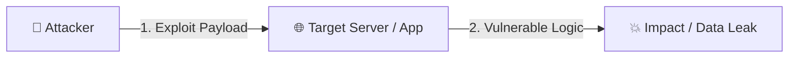

# 📅 Day [XXX]: [သင်ခန်းစာ ခေါင်းစဉ်]

> **Phase:** [Phase X] | **Date:** YYYY-MM-DD | **Time Spent:** 60 Mins  
> **Tech Stack Involved:** [Linux / Nginx / Laravel / Docker / API]  
> **🎓 Certification Alignment:** [ISC2 CC Domain X / CompTIA Security+ / APIsec]

---

## 🧠 1. The Story & How It Works Under the Hood (15 Mins)

### ဘာကြောင့် ဒီပြဿနာ ဖြစ်ရတာလဲ?
[ဒီနေရာမှာ သဘောတရားနဲ့ လက်တွေ့ ဥပမာကို ရိုးရှင်းရှင်းလင်းစွာ ရေးပါ]



---

## 🔴 2. Red Team Lab — Hacker မျက်စိဖြင့် ဖောက်ထွင်းစမ်းသပ်ခြင်း (15 Mins)

### 🎯 Lab Target & Objective
- **Lab Environment:** [Local Docker / PortSwigger / OverTheWire / CLI]
- **Goal:** [ဘာကို ဖော်ထုတ်/ဖောက်ထွင်းမလဲ]

### 💻 Commands & Steps Executed
```bash
# Step 1: Reconnaissance / Attack Command
```

### 🔍 တွေ့ရှိချက် (Observation)
- [Command ရလဒ်က ဘာကို ပြနေသလဲ?]

---

## 🔵 3. Blue Team / DevSecOps Fix — ဘယ်လို အပြီးတိုင် ကာကွယ်မလဲ? (15 Mins)

### 🛡️ Production Fix (Laravel / Nginx / Linux / Docker)

```php
// ❌ Vulnerable Code / Config


// ✅ Secure / Hardened Code / Config

```

### ✅ Verification (ပြန်လည်စမ်းသပ်ချက်)
- [ပြင်ဆင်ပြီးနောက် Attack ပြန်စမ်းသည့်အခါ Blocked (403/404/Safe) ဖြစ်သွားကြောင်း သက်သေ]

---

## 🎓 4. Certification Exam Check (စာမေးပွဲ အလေ့အကျင့် မေးခွန်း)

**❓ Sample Exam Question ([ISC2 CC / Security+ / APIsec]):**  
*[ဒီနေ့ သင်ခန်းစာနဲ့ သက်ဆိုင်တဲ့ နိုင်ငံတကာ စာမေးပွဲ မေးခွန်းပုံစံ ၁ ပုဒ်]*
- **A)** Option A
- **B)** Option B
- **C)** Option C
- **D)** Option D

<details>
<summary>💡 <b>အဖြေမှန်နှင့် ရှင်းလင်းချက် ကြည့်ရန် နှိပ်ပါ</b></summary>

- **အဖြေမှန်:** **[X]**
- **ရှင်းလင်းချက်:** [ဘာကြောင့် ဒီအဖြေ မှန်ရသလဲ]
</details>

---

## 📢 5. Share to the World (15 Mins Content Creation)

### 📝 Option A: Blog / Medium / Dev.to / Facebook Post Draft
> **Title:** [စိတ်ဝင်စားဖို့ကောင်းသော ခေါင်းစဉ်]  
> 
> Developer တော်တော်များများ သတိမထားမိတတ်တဲ့ Security အမှားတစ်ခုအကြောင်း ဒီနေ့ လက်တွေ့ စမ်းသပ်ဖြစ်ခဲ့ပါတယ်။  
> 
> **🔍 ပြဿနာက ဘာလဲ?**  
> - [အချက် ၁]  
> - [အချက် ၂]  
> 
> **🛡️ ဘယ်လို ကာကွယ်မလဲ?**  
> - [အချက် ၁]  
> - [အချက် ၂]  
> 
> `#100DaysOfCybersecurity` `#DevSecOps` `#LaravelSecurity` `#WebSecurity`

---

### 🎬 Option B: YouTube Shorts / TikTok 60-Second Video Script
- **⚡ 00:00 – 00:08 (The Hook):**  
  *"[ပရိသတ် ချက်ချင်း စိတ်ဝင်စားသွားမယ့် မေးခွန်း သို့မဟုတ် သတိပေးချက်]"*
- **📖 00:08 – 00:25 (The Story / Problem):**  
  *"နောက်ကွယ်မှာ ဘာဖြစ်နေလဲဆိုတော့..."*
- **💻 00:25 – 00:45 (The Demo & Fix):**  
  *"ဒီမှာ ကြည့်လိုက်ရင် Hacker က ဒီလို ဝင်လာတယ်... အဲ့ဒါကို ငါတို့ Code/Server မှာ ဒီ ၂ ကြောင်းလေးနဲ့ ပိတ်လိုက်လို့ ရတယ်!"*
- **🎯 00:45 – 01:00 (The Takeaway & CTA):**  
  *"ဒါက Day [XXX] of 100 Days of Cybersecurity ပါ။ မင်းတို့ Project မှာရော ဒါလေး စစ်ပြီးပြီလား? Follow လုပ်ထားကြနော်!"*
